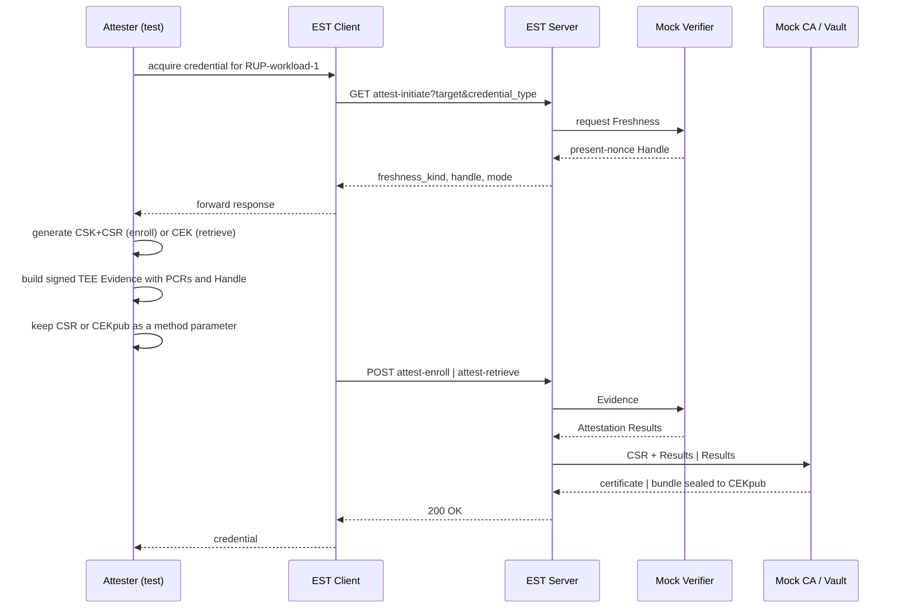

# EST attested credential acquisition (TACRA extensions)

This document describes the TACRA attested credential acquisition extensions
added to the workspace `globalsign-est` project, and the integration test that
validates them in [est_attest_test.go](est_attest_test.go).

The proof of concept covers the EST protocol binding only: `attest-initiate`,
`attest-enroll` and `attest-retrieve`, in RATS **Passport model**, behind the
CAS Server. The Verifier, Credential Authority and Secret Vault are mocked in
process.

## TACRA role mapping

TACRA defines a Credential Acquisition System (CAS) comprising a CAS Client and
a CAS Server, invoked by the Attester through the Credential Acquisition
Interface (CAI). This POC maps those roles onto the workspace as follows.

| TACRA role | Component | POC treatment |
| --- | --- | --- |
| Attester + CAI | [est_attest_test.go](est_attest_test.go) | The test plays Attester and CAI |
| CAS Client | `est.Client` in [../../globalsign-est/attest_client.go](../../globalsign-est/attest_client.go) | Extended with three methods |
| CAS Server | `est.NewRouter` in [../../globalsign-est/server.go](../../globalsign-est/server.go) | Extended with three resources |
| Verifier | veraison-services | **Mocked** in `internal/mockca` |
| Credential Authority | step-ca | **Mocked** by the existing `MockCA` |
| Secret Vault | hashicorp-vault | **Mocked** in `internal/mockca` |
| RATS-unaware Relying Party | `RUP-workload-1` | Whitelisted target |

Consistent with TACRA, the CAS Client and CAS Server act as **conduits only**.
The mock EST server forwards Evidence and Attestation Results and does not
appraise, modify or replace them.

## Protocol

Three resources are added under the existing EST `/.well-known/est/` prefix,
alongside the unchanged RFC 7030 resources. Each is also served under an
additional path segment, matching existing EST behaviour.

| Resource | Method | Request | Success response |
| --- | --- | --- | --- |
| `attest-initiate` | GET | query parameters | `AttestationInitiateResponse` (JSON) |
| `attest-enroll` | POST | `AttestedEnrollmentRequest` (JSON) | PKCS#7 certificate, as `simpleenroll` |
| `attest-retrieve` | POST | `AttestedRetrievalRequest` (JSON) | `EncryptedCredentialBundle` (JSON) |

All exchanges use HTTPS with server authentication, as RFC 7030 requires.
Envelopes are JSON, satisfying the draft requirement to support at least one of
CBOR or JSON. Evidence and Endorsements are opaque byte strings.

## Two-leg flow

Both modes use two legs. Leg one obtains Freshness; leg two submits Evidence.



### Freshness

All five TACRA Freshness Kinds are implemented by the mock profile. Freshness
policy is configured per Target; `attest-initiate` reports that policy, and the
second leg must match it.

| Kind | Behaviour |
| --- | --- |
| `present-nonce` | The Verifier originates a single-use 32-byte Handle with a 300 second lifetime. The Attester embeds it in Evidence. Replay, expiry or an unknown Handle yields `409 Conflict`. |
| `present-epoch` | The Verifier returns the Target's configured current epoch marker as the Handle. Evidence embeds it; a marker that no longer equals current policy yields `409 Conflict`. |
| `absent-timestamp` | The Attester uses its trusted clock and omits the Handle. The Verifier checks the signed EAT `iat` against the Target's configured `max_age` and a five-second future-clock-skew allowance. |
| `absent-epoch` | Initiation returns no Handle. The Attester supplies its locally held epoch marker in the second-leg `handle` field and embeds it in Evidence; a stale marker yields `409 Conflict`. |
| `absent-none` | No freshness claim and no Handle. |

For any `absent-*` kind, an EST client that already knows the freshness policy,
mode, algorithm suite, and `server_id` completes initiation locally and **must
not contact the server**. The integration tests also call `attest-initiate` for
absent Targets to verify that server-side policy discovery returns no Handle.
The mock EAT uses its nonce claim for nonce and epoch freshness elements and
its issued-at claim for `absent-timestamp`.

### Mechanism selection

The **CAS Server decides the mechanism**, and it is **not** a function of the
credential type. TACRA line 80 states the CAS "controls which Credential Types
and which Credential Acquisition Mechanisms (enrollment, retrieval) can be
provisioned to the Attester for any Attester-supplied target, without the
Attester's knowledge or involvement", and Req 5 requires support for "different
Credential Acquisition Mechanisms **per-target**".

Responsibilities split as follows:

| Concern | Owner | Source |
| --- | --- | --- |
| Target | Attester supplies it | `Acquire-Credential(Target, Credential Type)` |
| Credential type | Attester supplies it | Req 1: "the workload knows what Credential Type it will need when it launches" |
| Mechanism | **CAS Server decides it** | Req 1: the workload "discovers whether it will have to retrieve an existing or enroll a new credential at runtime" |
| Mechanism dispatch | CAI branches on it | Line 86: "opaquely to the Attester, the CAI **discovers** and utilizes one of two Credential Acquisition Modes" |

The mock therefore configures the mechanism **per target**, and any credential
type the target permits resolves to that same mechanism:

| Target | Mechanism | Required binding |
| --- | --- | --- |
| `RUP-workload-1` | `enroll` | `binding-input` |
| `RUP-workload-2` | `retrieve` | `binding-input` |

A target may optionally restrict which credential types it will provision via
`credential_types`. That is a capability check only — line 80: "If a Credential
Type specified by the Attester is unavailable due to Credential Acquisition
System limitations, an error will result" — and it never changes the mechanism.

### Binding

Evidence must bind more than the CSR or CEK: the updated EST profile
(`zz_suds-docs/est_lamps-tacra-est-updates`) also requires an Evidence-to-Server
and an Evidence-to-Target binding, so that a conduit cannot carry a genuine
request to a different EST Server (server substitution) or present it under a
Target the Attester did not choose (target substitution). This mock closes all
three with a single digest, the draft's direct-form `binding-input`:

```text
binding_input = len32(handle)    || handle
             || len32(server_id) || server_id
             || len32(target)    || target
             || len32(subject)   || subject
```

`len32` is a 32-bit big-endian octet count; `subject` is the CSR DER for
enrollment or the CEKpub SubjectPublicKeyInfo DER for retrieval; `handle` is
empty for `absent-none`. The digest is SHA-512, matching a 64-octet
report-data field such as AMD SEV-SNP `REPORT_DATA` or Intel TDX `REPORTDATA`.
[`EncodeBindingInput` and `BindingDigest`](../../globalsign-est/attest.go)
implement the framing and digest; the mock Attester embeds the digest in a new
EAT claim (label `-70005`), and the mock Verifier/Credential Authority/Secret
Vault in [`internal/mockca/attest.go`](../../globalsign-est/internal/mockca/attest.go)
recompute it from their own `server_id`, the Target the Handle was issued for,
and the CSR or CEKpub they received, refusing the request on any mismatch —
this is the only binding method the mock server accepts
(`Binding{Method: est.BindingInput, Hash: "sha512"}`). The length prefixes are
what make the encoding unambiguous: without them, `server_id="AB", target="CD"`
and `server_id="ABC", target="D"` would hash identically.

`BindingCSRHash` and `BindingCEKThumbprint` remain defined for documentation —
they are two of the CSR-only Evidence-to-CSR mechanisms the draft lists — but
this mock no longer accepts them alone, since they do not cover the
Evidence-to-Server and Evidence-to-Target requirements.

The attest-initiate response now also carries a required `server_id`, naming
the EST Server the Handle and mode were issued by. The Attester **MUST**
compare it with the EST Server it is configured to use for the Target and
**MUST NOT** produce Evidence on a mismatch; the test's `serverID()` helper and
the `Initiate/EnrollMode` and `Initiate/RetrieveMode` subtests assert this
field is present, and `Enroll/ServerSubstitution`, `Enroll/TargetSubstitution`
and `Retrieve/ServerSubstitution` assert that Evidence bound to the wrong
server or Target is rejected with `403`.

This mock's `server_id` (`twi-globalsign-est`) is currently a fixed constant in
`internal/mockca/attest.go`, not yet derived from the deployment's TLS endpoint
or made configurable — a known PoC simplification, not a protocol limitation.

An optional `credential_hint` (advisory only, never authorization) now flows
end-to-end: `AttestedEnrollmentRequest`/`AttestedRetrievalRequest` carry it,
the mock Secret Vault folds it into `group_id` alongside the attestation
subject and policy version, and the retrieval bundle's associated data
authenticates it together with `server_id` and `target`.

Because the mechanism is fixed by the CAS, posting the wrong second leg for a
target is rejected with `403`.

## Attested Enrollment Mode

The Attester generates a Content Signing Key and CSR separately from signed
mock TEE Evidence. Evidence is a CBOR-encoded, tagged COSE Sign1 EAT using
ES256. Its protected headers carry `alg=ES256` and
`content-type=application/eat+cwt`; its unprotected `kid` identifies the mock
provider key. The EAT carries standard TEE claims, PCR measurements, the
Freshness kind, and the applicable nonce, epoch marker, or timestamp.
`AttestedEnrollmentRequest` carries `target`,
`credential_type`, `freshness_kind`, `handle`, `csr`, `evidence`, `binding` and
an optional `credential_hint`.

Server processing follows the draft ordering: validate syntax and media type,
correlate the Handle, forward Evidence to the Verifier, then forward the CSR
and Attestation Results to the Credential Authority, which verifies proof of
possession and authorises issuance.

The mock Verifier validates the provider's P-256 public-key trust anchor and
COSE signature, appraises the PCR values, and compares the signed Freshness
with the request and the preceding attest-initiate result. Proof of possession
of the CSR key is verified separately by checking the CSR's own signature. The
`binding` object is no longer just request metadata: Evidence itself now
carries a digest (the mock EAT's `-70005` claim) covering the CSR (or CEKpub),
`server_id` and Target, computed as described in [Binding](#binding), and the
Verifier/Credential Authority recompute and compare it before issuance.

### Mock EAT profile

The profile URI is
`https://twi.confidentialcomputing.io/tacra-est-mock/1.0.0`, advertised as:

```text
application/eat+cwt; eat_profile="https://twi.confidentialcomputing.io/tacra-est-mock/1.0.0"
```

The `est` module is also included in [`../go.work`](../go.work), so it can be
used as part of the TACRA workspace.

## Starting the EST server

From the workspace root, build and deploy the EST component with:

```bash
./tacra/deploy/components.sh build --components globalsign-est
./tacra/deploy/components.sh deploy --components globalsign-est
```

The deployment script starts a container named `twi-globalsign-est` using the
local configuration under:

```text
tacra/deploy/config/local/globalsign-est
```

The subject is taken from Attestation Results rather than raw Evidence, so it
does not vary with the nonce. Workloads attesting to the same subject therefore
share a group — the replica workload case — and receive an identical
credential. The vault mints each group credential once and caches it.

### Encryption

The draft requires exactly one mandatory-to-implement mechanism and lists CMS
EnvelopedData, HPKE and COSE_Encrypt0 as candidates. This POC uses a
stdlib-only HPKE-like construction, labelled in the `enc` field:

```text
ECDH-P256+HKDF-SHA256+A256GCM
```

The vault performs ECDH against `CEKpub` using an ephemeral key, derives a
256-bit key with HKDF-SHA256, and seals the bundle with AES-256-GCM. The
associated data binds `group_id`, `server_id`, `target`, `handle` (when
present) and `credential_hint` (when present), matching the draft's
`encrypted-credential-bundle` `aad` structure.

Only the holder of `CEKpri` can open the result. The EST client and EST server
never see the plaintext credential, satisfying TACRA requirement 10. The test
asserts this directly by decrypting with `CEKpri` alone and by confirming that
a different key fails.

**Not yet implemented:** the bundle's origin is not authenticated. The draft
requires the Attester to verify the container came from the Secret Vault
(HPKE `mode_auth` or a Vault signature over the container) before trusting its
AAD or decrypting it; this mock's `EncryptedCredentialBundle` has no such
signature, so a conduit that has observed `CEKpub` could still forge a
well-formed container. Closing this ("bundle substitution" in the draft's
Security Considerations) is future work, not part of this change.

The decrypted `CredentialBundle` carries the group ID, metadata, and credential
items typed `x509-cert`, `pkcs8-key` and `ca-certs-pem`.

## Implementation notes

The `CA` interface in [../../globalsign-est/ca.go](../../globalsign-est/ca.go)
is **unchanged**. Attestation support is a separate optional interface,
`est.AttestationCA`, which the server type-asserts per request. A backing CA
that does not implement it causes the attest resources to return `501 Not
Implemented`, and every existing `CA` implementation continues to compile and
behave identically.

Likewise `MockCA` is untouched. `mockca.AttestedCA` embeds it, so it still
satisfies `est.CA` while adding the three attested operations.

## Changes to globalsign-est

Three files were added and five modified. No existing function signature,
interface or exported type was changed, so the extensions are purely additive.

### Files added

| File | Lines | Contents |
| --- | --- | --- |
| `attest.go` | ~670 | Protocol types, the `est.AttestationCA` optional interface, credential/mechanism constants, the `EncodeBindingInput` / `BindingDigest` binding construction, `SealCredentialBundle` / `Open` crypto, and the three server handlers |
| `attest_client.go` | ~150 | Client methods `InitiateRemoteAttestation`, `EnrollCredential`, `RetrieveCredential`, plus the shared `postAttest` helper |
| `internal/mockca/attest.go` | ~535 | `mockca.AttestedCA`: mock Verifier, mock Credential Authority and mock Secret Vault, Handle store, binding-input recomputation, and target whitelist |

### Files modified

| File | Change |
| --- | --- |
| `server.go` | Registered `attest-initiate` (GET), `attest-enroll` (POST) and `attest-retrieve` (POST) on both the base router and the additional-path-segment sub-router; added three log message constants. No existing route or handler altered. |
| `common.go` | Added `attestInitiateEndpoint`, `attestEnrollEndpoint`, `attestRetrieveEndpoint` to the URI block, and the `attestTargetParam` / `attestCredentialTypeParam` query parameter names. Existing constants unchanged. |
| `errors.go` | Added `errAttestNotSupported` (501) and `errInvalidJSON` (400). Existing error values unchanged. |
| `cmd/estserver/config.go` | Added the `attest` config section with `allowed_targets`, and included it in the sample configuration. |
| `cmd/estserver/main.go` | Wrapped the mock CA with `mockca.NewAttested(ca, cfg.Attest.Targets, trustedProviderKey)` before passing it to `est.NewRouter`. |

### Files deliberately not modified

`ca.go` keeps the `CA` interface exactly as it was — attestation is a separate
optional interface — so every existing backing CA implementation compiles and
behaves identically. `internal/mockca/ca.go` is likewise untouched;
`AttestedCA` embeds `MockCA` rather than altering it. `client.go`, `http.go`,
`encoding.go` and `csrattrs.go` are unchanged.

The existing `maxBodySize(65536)` and `requireContentType` middleware are
reused rather than duplicated, and `writeResponse` already handled `[]byte`
bodies, so no encoding changes were needed.

## CAAPI alignment

The EST client is the CAS Client in TACRA terms, so its operations are named
after the RPCs in
[caapi.proto](../proto/caapi/v1/caapi.proto). The EST resource paths follow the
EST extension draft; only the Go API is CAAPI-aligned.

| `caapi.v1` RPC | EST client method | EST resource |
| --- | --- | --- |
| `InitiateRemoteAttestation` | `Client.InitiateRemoteAttestation` | `GET attest-initiate` |
| `EnrollCredential` | `Client.EnrollCredential` | `POST attest-enroll` |
| `RetrieveCredential` | `Client.RetrieveCredential` | `POST attest-retrieve` |

Message fields map as follows. Where the two specifications use different
names, the EST wire format follows the draft and the Go field name follows
CAAPI.

| CAAPI field | EST equivalent | Note |
| --- | --- | --- |
| `target` | `target` | Query parameter on leg one, body field on leg two |
| `credential_type` | `credential_type` | See the enum mapping below |
| `mechanism` | `AttestationInitiateResponse.Mechanism` | JSON tag remains `mode` per the draft |
| `challenge` | `AttestationInitiateResponse.Handle` | The draft calls this the Handle |
| `evidence` | `evidence` | Opaque byte string in both |
| `csr` | `csr` | DER-encoded PKCS#10 |
| `plaintext_credential` | PKCS#7 response body | Returned as for `simpleenroll` |
| `wrapped_credential` | `EncryptedCredentialBundle` | Sealed to CEKpub |
| `credential_hint` | `credential_hint` | Advisory only; folded into `group_id` and the bundle's AAD, never authorization |

`CredentialAcquisitionMechanism` maps to `est.MechanismEnroll` and
`est.MechanismRetrieve`. `OPERATION_UNSPECIFIED` has no EST equivalent; the
server always returns a concrete mechanism.

`CredentialType` maps onto EST wire strings. The type is supplied by the
Attester and validated by the CAS, but it does **not** determine the mechanism.

| CAAPI enum | `est` constant | Value |
| --- | --- | --- |
| `BT_CREDENTIAL_TYPE_JWT` | `CredentialTypeJWT` | `jwt` |
| `BT_CREDENTIAL_TYPE_PSK` | `CredentialTypePSK` | `psk` |
| `BT_CREDENTIAL_TYPE_API_KEY` | `CredentialTypeAPIKey` | `api-key` |
| `POP_CREDENTIAL_TYPE_X509` | `CredentialTypeX509` | `x509` |
| `POP_CREDENTIAL_TYPE_WIC` | `CredentialTypeWIC` | `wic` |
| `POP_CREDENTIAL_TYPE_WIT` | `CredentialTypeWIT` | `wit` |

The mock always issues an X.509 credential regardless of the requested type, so
the type is carried and validated but not yet honoured in the payload.

The CAAPI `InitiateCredentialAcquistionRequest` message name contains a typo in
the proto. It is left as-is here since the generated bindings depend on it.

### Error mapping

| Status | Condition |
| --- | --- |
| `400` | Malformed envelope, missing CSR, unsupported freshness kind or binding method |
| `403` | Target not whitelisted, provider signature or PCR appraisal failed, Evidence not bound to Handle, server_id, Target or key material (CSR/CEKpub) |
| `409` | Handle replay, expiry, or unknown Handle |
| `415` | Content type is not `application/json` |
| `501` | Backing CA does not implement `est.AttestationCA` |

Error bodies carry no attestation detail.

## Configuration

The whitelist lives in the EST server configuration, with the mechanism set per
target:

```json
"attest": {
  "trusted_provider_public_key": "/etc/est/certs/mock-tee-provider-public-key.pem",
  "targets": [
    { "name": "RUP-workload-1", "mechanism": "enroll" },
    { "name": "RUP-workload-2", "mechanism": "retrieve" }
  ]
}
```

Each entry may also carry `credential_types` to restrict which types the CAS
will provision for that target.

The local generator creates a P-256 provider key pair. The Attester test reads
the private key from the sibling `local/mock-tee-provider/key.pem` directory;
the EST server mount receives only
`certs/mock-tee-provider-public-key.pem`. If the `attest` section is absent,
attestation resources return `501 Not Implemented`.

It is emitted by [../deploy/init-local-est-config.sh](../deploy/init-local-est-config.sh)
into `tacra/deploy/config/local/globalsign-est/estserver.json`. If the section
is absent, the two default targets above are configured.

## Running the tests

The tests run against the deployed container, so a change to `globalsign-est`
requires a rebuild before it takes effect:

```bash
./tacra/deploy/components.sh build  --components globalsign-est
./tacra/deploy/components.sh deploy --components globalsign-est
```

Then:

```bash
cd tacra/est
go test -v -count=1 ./...
```

`-count=1` disables Go's test result cache, which matters because these tests
talk to a live container.

`TestBindingInputEncoding` and `TestBindingInputUnambiguous` verify the
`EncodeBindingInput` / `BindingDigest` framing directly and do not require a
running container, so they also run under `go test -short`.
`TestMockEvidenceFreshnessKinds` verifies Evidence generation for all five
kinds without a container. `TestAllFreshnessKinds` exercises initiation,
enrollment, and retrieval for every kind and rejects stale/future timestamps,
stale epoch markers, and a request that does not match Target freshness policy.
The
`Enroll/ServerSubstitution`, `Enroll/TargetSubstitution` and
`Retrieve/ServerSubstitution` subtests of `TestAttestedCredentialAcquisition`
do require the container: they bind Evidence to a server or Target other than
the one requested and assert the Credential Authority / Secret Vault reject it
with `403`.

The test defaults are defined in [est_attest.json](est_attest.json). It contains the EST host,
`server_id` the mock server is expected to report, client Common Name, CA and
mock-provider key paths, target names, and credential types. The test loads
this file once before running and rejects unknown fields, missing required
values, or additional JSON values. Paths in the file are resolved from the
`est` module directory, matching the `go test` command above.

### Overrides

| Environment variable | Default | Description |
| --- | --- | --- |
| `EST_TEST_CONFIG` | `est_attest.json` | Alternate JSON test configuration file. |
| `EST_HOST` | configured value | Host and port of the EST server. |
| `EST_CN` | configured value | Common Name placed in generated CSRs. |
| `EST_CA_CERT` | configured value | PEM CA certificate used as the TLS and certificate-verification anchor. |
| `EST_PROVIDER_KEY` | configured value | Mock TEE provider EC private key used to sign Evidence. |
| `EST_TARGET` | configured value | Enrollment target name. |
| `EST_RETRIEVE_TARGET` | configured value | Retrieval target name. |
| `EST_APS` | empty | Additional EST path segment passed to the client library. |
| `EST_SANS` | empty | Comma-separated DNS names placed in generated CSRs. |
| `EST_BIT_SIZE` | empty | Value of the `Bit-Size` header sent for `ServerKeyGen`. |

Example:

```bash
EST_CN=my-workload \
EST_SANS=localhost,my-workload \
EST_BIT_SIZE=3072 \
go test -v -count=1 ./...
```

The test does not use the server `/healthcheck` endpoint and therefore does
not require its basic-auth password.

## Troubleshooting

If the test reports a connection error, confirm that the container is running
and that host port `9444` is published:

```bash
docker ps --filter name=twi-globalsign-est
docker logs twi-globalsign-est
```

Without local EST configuration or a running `twi-globalsign-est` container,
`go test` skips `TestESTOperations` instead of failing. Set `EST_CA_CERT` to an
explicit path only when the file should already exist; a missing explicit path
is still a failure.

If the local CA files are missing or expired, regenerate the local EST
configuration from the workspace root:

```bash
./tacra/deploy/init-local-est-config.sh
```

Then recreate the EST container so it uses the regenerated certificates:

```bash
./tacra/deploy/components.sh deploy --components globalsign-est
```
