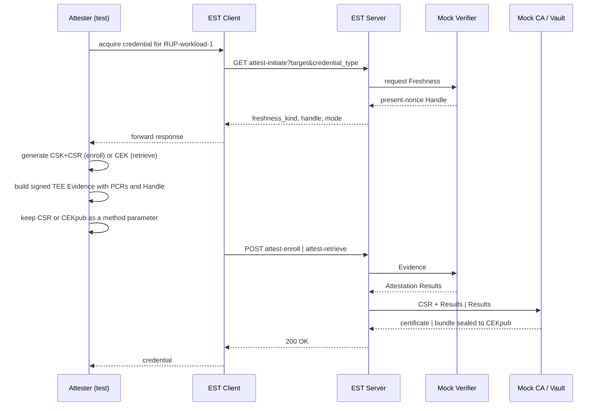

# EST attested credential acquisition (TACRA extensions)

This document describes the TACRA attested credential acquisition extensions
added to the workspace `globalsign-est` project, and the integration test that
validates them in [est_attest_test.go](est_attest_test.go).

The proof of concept covers the EST protocol binding only: `attest-initiate`,
`attest-enroll` and `attest-retrieve`, in RATS **Passport model**, behind the
CAS Server. The Verifier, Credential Authority and Secret Vault are mocked in
process.

## TACRA role mapping

TACRA defines a Credential Acquisition System (CAS) comprising a CAS Client and
a CAS Server, invoked by the Attester through the Credential Acquisition
Interface (CAI). This POC maps those roles onto the workspace as follows.

| TACRA role | Component | POC treatment |
| --- | --- | --- |
| Attester + CAI | [est_attest_test.go](est_attest_test.go) | The test plays Attester and CAI |
| CAS Client | `est.Client` in [../../globalsign-est/attest_client.go](../../globalsign-est/attest_client.go) | Extended with three methods |
| CAS Server | `est.NewRouter` in [../../globalsign-est/server.go](../../globalsign-est/server.go) | Extended with three resources |
| Verifier | veraison-services | **Mocked** in `internal/mockca` |
| Credential Authority | step-ca | **Mocked** by the existing `MockCA` |
| Secret Vault | hashicorp-vault | **Mocked** in `internal/mockca` |
| RATS-unaware Relying Party | `RUP-workload-1` | Whitelisted target |

Consistent with TACRA, the CAS Client and CAS Server act as **conduits only**.
The mock EST server forwards Evidence and Attestation Results and does not
appraise, modify or replace them.

## Protocol

Three resources are added under the existing EST `/.well-known/est/` prefix,
alongside the unchanged RFC 7030 resources. Each is also served under an
additional path segment, matching existing EST behaviour.

| Resource | Method | Request | Success response |
| --- | --- | --- | --- |
| `attest-initiate` | GET | query parameters | `AttestationInitiateResponse` (JSON) |
| `attest-enroll` | POST | `AttestedEnrollmentRequest` (JSON) | PKCS#7 certificate, as `simpleenroll` |
| `attest-retrieve` | POST | `AttestedRetrievalRequest` (JSON) | `EncryptedCredentialBundle` (JSON) |

All exchanges use HTTPS with server authentication, as RFC 7030 requires.
Envelopes are JSON, satisfying the draft requirement to support at least one of
CBOR or JSON. Evidence and Endorsements are opaque byte strings.

### Deviation: target conveyance on attest-initiate

The EST extension draft specifies attest-initiate as "a GET with no body and no
query parameters". TACRA, however, defines
`Initiate-Credential-Acquisition(Target, Credential Type)` and requires the CAS
to validate "that the indicated Target name and Credential Type are supported".

These cannot both hold. The server must know the target in order to whitelist
`RUP-workload-1` and to decide whether the target is acquired by enrollment or
retrieval. This POC therefore conveys them as query parameters:

```text
GET /.well-known/est/attest-initiate?target=RUP-workload-1&credential_type=x509
```

This is a deliberate, documented deviation from the draft text. The draft
carries `TODO: validate everything below` over most of these structures, so the
conflict is expected to be resolved upstream.

## Two-leg flow

Both modes use two legs. Leg one obtains Freshness; leg two submits Evidence.



### Freshness

Two kinds are implemented:

| Kind | Behaviour |
| --- | --- |
| `present-nonce` | The Verifier originates a single-use 32-byte Handle with a 300 second lifetime. The Attester embeds it in Evidence. Replay, expiry or an unknown Handle yields `409 Conflict`. |
| `absent-none` | No freshness claim. Per the draft, the client completes attest-initiate **locally and must not contact the server**, then posts leg two directly. |

`present-epoch`, `absent-epoch` and `absent-timestamp` are not implemented in
this POC.

### Mechanism selection

The **CAS Server decides the mechanism**, and it is **not** a function of the
credential type. TACRA line 80 states the CAS "controls which Credential Types
and which Credential Acquisition Mechanisms (enrollment, retrieval) can be
provisioned to the Attester for any Attester-supplied target, without the
Attester's knowledge or involvement", and Req 5 requires support for "different
Credential Acquisition Mechanisms **per-target**".

Responsibilities split as follows:

| Concern | Owner | Source |
| --- | --- | --- |
| Target | Attester supplies it | `Acquire-Credential(Target, Credential Type)` |
| Credential type | Attester supplies it | Req 1: "the workload knows what Credential Type it will need when it launches" |
| Mechanism | **CAS Server decides it** | Req 1: the workload "discovers whether it will have to retrieve an existing or enroll a new credential at runtime" |
| Mechanism dispatch | CAI branches on it | Line 86: "opaquely to the Attester, the CAI **discovers** and utilizes one of two Credential Acquisition Modes" |

The mock therefore configures the mechanism **per target**, and any credential
type the target permits resolves to that same mechanism:

| Target | Mechanism | Required binding |
| --- | --- | --- |
| `RUP-workload-1` | `enroll` | `csr-hash` |
| `RUP-workload-2` | `retrieve` | `cek-thumbprint` |

A target may optionally restrict which credential types it will provision via
`credential_types`. That is a capability check only — line 80: "If a Credential
Type specified by the Attester is unavailable due to Credential Acquisition
System limitations, an error will result" — and it never changes the mechanism.

Because the mechanism is fixed by the CAS, posting the wrong second leg for a
target is rejected with `403`.

## Attested Enrollment Mode

The Attester generates a Content Signing Key and CSR separately from signed
mock TEE Evidence. Evidence is a CBOR-encoded, tagged COSE Sign1 EAT using
ES256. Its protected headers carry `alg=ES256` and
`content-type=application/eat+cwt`; its unprotected `kid` identifies the mock
provider key. The EAT carries standard TEE claims, PCR measurements, and the
Freshness kind and Handle returned by attest-initiate. `AttestedEnrollmentRequest` carries `target`,
`credential_type`, `freshness_kind`, `handle`, `csr`, `evidence` and `binding`.

Server processing follows the draft ordering: validate syntax and media type,
correlate the Handle, forward Evidence to the Verifier, then forward the CSR
and Attestation Results to the Credential Authority, which verifies proof of
possession and authorises issuance.

The mock Verifier validates the provider's P-256 public-key trust anchor and
COSE signature, appraises the PCR values, and compares the signed Freshness
with the request and the preceding attest-initiate result. The CSR remains a
request parameter, and proof of possession is verified separately by checking
its signature. The `binding` object remains request metadata; this POC does not
place CSR data in Evidence.

### Mock EAT profile

The profile URI is
`https://twi.confidentialcomputing.io/tacra-est-mock/1.0.0`, advertised as:

```text
application/eat+cwt; eat_profile="https://twi.confidentialcomputing.io/tacra-est-mock/1.0.0"
```

The payload uses standard EAT/CWT labels for `iss`, `sub`, `iat`, `nonce`,
`ueid`, `hwmodel`, `oemboot`, `dbgstat`, `eat_profile`, `bootcount`, `bootseed`
and `swname`. Private profile label `-70003` carries the PCR map and `-70004`
carries `freshness_kind`. For `present-nonce`, EAT `nonce` contains the exact
Handle from `attest-initiate`; for `absent-none`, `nonce` is absent.

Target, credential type, CSR, CEK public key, binding, profile request and
endorsements are never EAT claims. They remain method parameters in the EST
request envelope.

## Attested Retrieval Mode

The Attester generates a Content Encryption Key (ECDH P-256). `CEKpub` is a
field of `AttestedRetrievalRequest`, not part of Evidence. The signed mock TEE
Evidence has the same TEE and Freshness-only shape used for enrollment. The
mock Secret Vault maps Attestation Results onto a credential group:

```text
group_id = SHA-256(attestation_subject || profile || policy_version)
```

The subject is taken from Attestation Results rather than raw Evidence, so it
does not vary with the nonce. Workloads attesting to the same subject therefore
share a group — the replica workload case — and receive an identical
credential. The vault mints each group credential once and caches it.

### Encryption

The draft requires exactly one mandatory-to-implement mechanism and lists CMS
EnvelopedData, HPKE and COSE_Encrypt0 as candidates. This POC uses a
stdlib-only HPKE-like construction, labelled in the `enc` field:

```text
ECDH-P256+HKDF-SHA256+A256GCM
```

The vault performs ECDH against `CEKpub` using an ephemeral key, derives a
256-bit key with HKDF-SHA256, and seals the bundle with AES-256-GCM. The
associated data binds `group_id`, `handle`, `profile` and `server_id`.

Only the holder of `CEKpri` can open the result. The EST client and EST server
never see the plaintext credential, satisfying TACRA requirement 10. The test
asserts this directly by decrypting with `CEKpri` alone and by confirming that
a different key fails.

The decrypted `CredentialBundle` carries the group ID, metadata, and credential
items typed `x509-cert`, `pkcs8-key` and `ca-certs-pem`.

## Implementation notes

The `CA` interface in [../../globalsign-est/ca.go](../../globalsign-est/ca.go)
is **unchanged**. Attestation support is a separate optional interface,
`est.AttestationCA`, which the server type-asserts per request. A backing CA
that does not implement it causes the attest resources to return `501 Not
Implemented`, and every existing `CA` implementation continues to compile and
behave identically.

Likewise `MockCA` is untouched. `mockca.AttestedCA` embeds it, so it still
satisfies `est.CA` while adding the three attested operations.

## Changes to globalsign-est

Three files were added and five modified. No existing function signature,
interface or exported type was changed, so the extensions are purely additive.

### Files added

| File | Lines | Contents |
| --- | --- | --- |
| `attest.go` | ~420 | Protocol types, the `est.AttestationCA` optional interface, credential/mechanism constants, `SealCredentialBundle` / `Open` crypto, and the three server handlers |
| `attest_client.go` | ~150 | Client methods `InitiateRemoteAttestation`, `EnrollCredential`, `RetrieveCredential`, plus the shared `postAttest` helper |
| `internal/mockca/attest.go` | ~430 | `mockca.AttestedCA`: mock Verifier, mock Credential Authority and mock Secret Vault, Handle store, and target whitelist |

### Files modified

| File | Change |
| --- | --- |
| `server.go` | Registered `attest-initiate` (GET), `attest-enroll` (POST) and `attest-retrieve` (POST) on both the base router and the additional-path-segment sub-router; added three log message constants. No existing route or handler altered. |
| `common.go` | Added `attestInitiateEndpoint`, `attestEnrollEndpoint`, `attestRetrieveEndpoint` to the URI block, and the `attestTargetParam` / `attestCredentialTypeParam` query parameter names. Existing constants unchanged. |
| `errors.go` | Added `errAttestNotSupported` (501) and `errInvalidJSON` (400). Existing error values unchanged. |
| `cmd/estserver/config.go` | Added the `attest` config section with `allowed_targets`, and included it in the sample configuration. |
| `cmd/estserver/main.go` | Wrapped the mock CA with `mockca.NewAttested(ca, cfg.Attest.AllowedTargets)` before passing it to `est.NewRouter`. |

### Files deliberately not modified

`ca.go` keeps the `CA` interface exactly as it was — attestation is a separate
optional interface — so every existing backing CA implementation compiles and
behaves identically. `internal/mockca/ca.go` is likewise untouched;
`AttestedCA` embeds `MockCA` rather than altering it. `client.go`, `http.go`,
`encoding.go` and `csrattrs.go` are unchanged.

The existing `maxBodySize(65536)` and `requireContentType` middleware are
reused rather than duplicated, and `writeResponse` already handled `[]byte`
bodies, so no encoding changes were needed.

## CAAPI alignment

The EST client is the CAS Client in TACRA terms, so its operations are named
after the RPCs in
[caapi.proto](../proto/caapi/v1/caapi.proto). The EST resource paths follow the
EST extension draft; only the Go API is CAAPI-aligned.

| `caapi.v1` RPC | EST client method | EST resource |
| --- | --- | --- |
| `InitiateRemoteAttestation` | `Client.InitiateRemoteAttestation` | `GET attest-initiate` |
| `EnrollCredential` | `Client.EnrollCredential` | `POST attest-enroll` |
| `RetrieveCredential` | `Client.RetrieveCredential` | `POST attest-retrieve` |

Message fields map as follows. Where the two specifications use different
names, the EST wire format follows the draft and the Go field name follows
CAAPI.

| CAAPI field | EST equivalent | Note |
| --- | --- | --- |
| `target` | `target` | Query parameter on leg one, body field on leg two |
| `credential_type` | `credential_type` | See the enum mapping below |
| `mechanism` | `AttestationInitiateResponse.Mechanism` | JSON tag remains `mode` per the draft |
| `challenge` | `AttestationInitiateResponse.Handle` | The draft calls this the Handle |
| `evidence` | `evidence` | Opaque byte string in both |
| `csr` | `csr` | DER-encoded PKCS#10 |
| `plaintext_credential` | PKCS#7 response body | Returned as for `simpleenroll` |
| `wrapped_credential` | `EncryptedCredentialBundle` | Sealed to CEKpub |

`CredentialAcquisitionMechanism` maps to `est.MechanismEnroll` and
`est.MechanismRetrieve`. `OPERATION_UNSPECIFIED` has no EST equivalent; the
server always returns a concrete mechanism.

`CredentialType` maps onto EST wire strings. The type is supplied by the
Attester and validated by the CAS, but it does **not** determine the mechanism.

| CAAPI enum | `est` constant | Value |
| --- | --- | --- |
| `BT_CREDENTIAL_TYPE_JWT` | `CredentialTypeJWT` | `jwt` |
| `BT_CREDENTIAL_TYPE_PSK` | `CredentialTypePSK` | `psk` |
| `BT_CREDENTIAL_TYPE_API_KEY` | `CredentialTypeAPIKey` | `api-key` |
| `POP_CREDENTIAL_TYPE_X509` | `CredentialTypeX509` | `x509` |
| `POP_CREDENTIAL_TYPE_WIC` | `CredentialTypeWIC` | `wic` |
| `POP_CREDENTIAL_TYPE_WIT` | `CredentialTypeWIT` | `wit` |

The mock always issues an X.509 credential regardless of the requested type, so
the type is carried and validated but not yet honoured in the payload.

The CAAPI `InitiateCredentialAcquistionRequest` message name contains a typo in
the proto. It is left as-is here since the generated bindings depend on it.

### Error mapping

| Status | Condition |
| --- | --- |
| `400` | Malformed envelope, missing CSR, unsupported freshness kind or binding method |
| `403` | Target not whitelisted, provider signature or PCR appraisal failed, Evidence not bound to Handle |
| `409` | Handle replay, expiry, or unknown Handle |
| `415` | Content type is not `application/json` |
| `501` | Backing CA does not implement `est.AttestationCA` |

Error bodies carry no attestation detail. `501` is a deviation from the draft's
status list, which has no code for an unsupported backing CA.

## Configuration

The whitelist lives in the EST server configuration, with the mechanism set per
target:

```json
"attest": {
  "trusted_provider_public_key": "/etc/est/certs/mock-tee-provider-public-key.pem",
  "targets": [
    { "name": "RUP-workload-1", "mechanism": "enroll" },
    { "name": "RUP-workload-2", "mechanism": "retrieve" }
  ]
}
```

Each entry may also carry `credential_types` to restrict which types the CAS
will provision for that target.

The local generator creates a P-256 provider key pair. The Attester test reads
the private key from the sibling `local/mock-tee-provider/key.pem` directory;
the EST server mount receives only
`certs/mock-tee-provider-public-key.pem`. If the `attest` section is absent,
attestation resources return `501 Not Implemented`.

It is emitted by [../deploy/init-local-est-config.sh](../deploy/init-local-est-config.sh)
into `twium/deploy/config/local/globalsign-est/estserver.json`. If the section
is absent, the two default targets above are configured.

## Running the tests

The tests run against the deployed container, so a change to `globalsign-est`
requires a rebuild before it takes effect:

```bash
./twium/deploy/components.sh build  --components globalsign-est
./twium/deploy/components.sh deploy --components globalsign-est
```

Then:

```bash
cd twium/est
go test -v -count=1 ./...
```

`-count=1` disables Go's test result cache, which matters because these tests
talk to a live container.

### Overrides

| Environment variable | Default | Description |
| --- | --- | --- |
| `EST_HOST` | `localhost:9444` | Host and port of the EST server. |
| `EST_CN` | `twi-unified-model-client` | Common Name placed in generated CSRs. |
| `EST_CA_CERT` | `../deploy/config/local/globalsign-est/certs/ca-certificates.pem` | PEM CA certificate used as the TLS and certificate-verification anchor. |
| `EST_APS` | empty | Additional EST path segment passed to the client library. |
| `EST_SANS` | empty | Comma-separated DNS names placed in generated CSRs. |
| `EST_TARGET` | `RUP-workload-1` | Enrollment target configured by the mock CAS. |
| `EST_RETRIEVE_TARGET` | `RUP-workload-2` | Retrieval target configured by the mock CAS. |

Pointing either target variable at a target that is not configured causes the
positive cases to fail with `403`.

### Coverage

| Subtest | Asserts |
| --- | --- |
| `Initiate/EnrollMode` | `present-nonce`, non-empty Handle, `mechanism=enroll`, `csr-hash` binding |
| `Initiate/RetrieveMode` | `mechanism=retrieve`, `cek-thumbprint` binding, advertised CEK suite |
| `Initiate/RejectedTarget` | Non-whitelisted target rejected with `403` |
| `Initiate/MechanismIndependentOfCredentialType` | Four credential types across both targets always yield the target's mechanism |
| `TestMockTEEEvidence` | Signed TEE Evidence verifies, excludes request fields, and rejects a tampered PCR |
| `Enroll/PresentNonce` | Certificate issued, CN preserved, chains to the local EST CA |
| `Enroll/AbsentNone` | Leg two succeeds with no prior server contact |
| `Enroll/ReplayedHandle` | Second use of a Handle rejected with `409` |
| `Enroll/EvidenceFreshnessMismatch` | Correctly signed Evidence carrying a different Handle rejected with `403` |
| `Enroll/TamperedMeasurement` | Evidence with a modified PCR rejected with `403` |
| `Enroll/WrongMechanismForTarget` | Enrolling against a retrieve target rejected with `403` |
| `Retrieve/PresentNonce` | Bundle decrypts with `CEKpri`; cert chains; key parses |
| `Retrieve/ReplicaStability` | Two Attesters, same subject, same `group_id` and credential |
| `Retrieve/WrongCEK` | A different CEK private key cannot open the bundle |
| `Retrieve/RejectedTarget` | Retrieval for a non-whitelisted target rejected with `403` |

## Known gaps

Background Check mode is not implemented; only Passport is. Evidence is a
non-production CBOR COSE Sign1 EAT signed with a locally generated P-256 mock
provider key and appraised against fixed PCR values; it has no endorsements or
real TEE trust chain. `present-epoch`,
`absent-epoch` and `absent-timestamp` are absent, so the epoch-moved retry path
is untested. The Handle store is in-memory and per-process, so it does not
survive a container restart or scale horizontally. Request envelopes still use
`application/json`; Evidence itself is advertised as the profile-specific
`application/eat+cwt` media type. Request bodies remain capped at 64 KB by the
existing EST middleware, which is ample for mock Evidence but may not suit real
attestation quotes.
