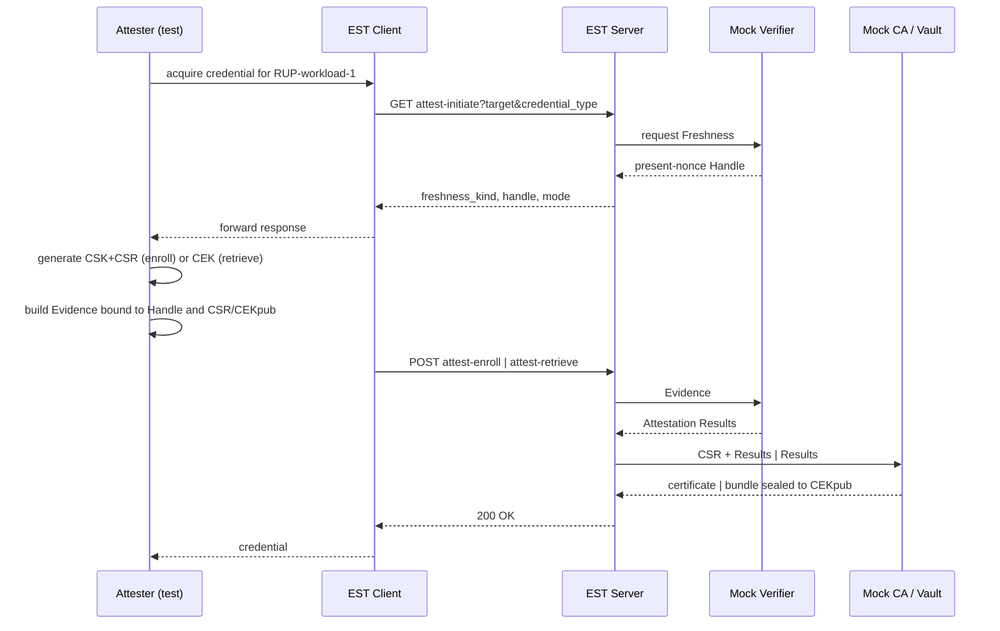

# EST attested credential acquisition (TACRA extensions)

This document describes the TACRA attested credential acquisition extensions
added to the workspace `globalsign-est` project, and the integration test that
validates them in [est_attest_test.go](est_attest_test.go).

The proof of concept covers the EST protocol binding only: `attest-initiate`,
`attest-enroll` and `attest-retrieve`, in RATS **Passport model**, behind the
CAS Server. The Verifier, Credential Authority and Secret Vault are mocked in
process.

## TACRA role mapping

TACRA defines a Credential Acquisition System (CAS) comprising a CAS Client and
a CAS Server, invoked by the Attester through the Credential Acquisition
Interface (CAI). This POC maps those roles onto the workspace as follows.

| TACRA role | Component | POC treatment |
| --- | --- | --- |
| Attester + CAI | [est_attest_test.go](est_attest_test.go) | The test plays Attester and CAI |
| CAS Client | `est.Client` in [../../globalsign-est/attest_client.go](../../globalsign-est/attest_client.go) | Extended with three methods |
| CAS Server | `est.NewRouter` in [../../globalsign-est/server.go](../../globalsign-est/server.go) | Extended with three resources |
| Verifier | veraison-services | **Mocked** in `internal/mockca` |
| Credential Authority | step-ca | **Mocked** by the existing `MockCA` |
| Secret Vault | hashicorp-vault | **Mocked** in `internal/mockca` |
| RATS-unaware Relying Party | `RUP-workload-1` | Whitelisted target |

Consistent with TACRA, the CAS Client and CAS Server act as **conduits only**.
The mock EST server forwards Evidence and Attestation Results and does not
appraise, modify or replace them.

## Protocol

Three resources are added under the existing EST `/.well-known/est/` prefix,
alongside the unchanged RFC 7030 resources. Each is also served under an
additional path segment, matching existing EST behaviour.

| Resource | Method | Request | Success response |
| --- | --- | --- | --- |
| `attest-initiate` | GET | query parameters | `AttestationInitiateResponse` (JSON) |
| `attest-enroll` | POST | `AttestedEnrollmentRequest` (JSON) | PKCS#7 certificate, as `simpleenroll` |
| `attest-retrieve` | POST | `AttestedRetrievalRequest` (JSON) | `EncryptedCredentialBundle` (JSON) |

All exchanges use HTTPS with server authentication, as RFC 7030 requires.
Envelopes are JSON, satisfying the draft requirement to support at least one of
CBOR or JSON. Evidence and Endorsements are opaque byte strings.

### Deviation: target conveyance on attest-initiate

The EST extension draft specifies attest-initiate as "a GET with no body and no
query parameters". TACRA, however, defines
`Initiate-Credential-Acquisition(Target, Credential Type)` and requires the CAS
to validate "that the indicated Target name and Credential Type are supported".

These cannot both hold. The server must know the target in order to whitelist
`RUP-workload-1` and to decide whether the target is acquired by enrollment or
retrieval. This POC therefore conveys them as query parameters:

```text
GET /.well-known/est/attest-initiate?target=RUP-workload-1&credential_type=x509
```

This is a deliberate, documented deviation from the draft text. The draft
carries `TODO: validate everything below` over most of these structures, so the
conflict is expected to be resolved upstream.

## Two-leg flow

Both modes use two legs. Leg one obtains Freshness; leg two submits Evidence.



### Freshness

Two kinds are implemented:

| Kind | Behaviour |
| --- | --- |
| `present-nonce` | The Verifier originates a single-use 32-byte Handle with a 300 second lifetime. The Attester embeds it in Evidence. Replay, expiry or an unknown Handle yields `409 Conflict`. |
| `absent-none` | No freshness claim. Per the draft, the client completes attest-initiate **locally and must not contact the server**, then posts leg two directly. |

`present-epoch`, `absent-epoch` and `absent-timestamp` are not implemented in
this POC.

### Mode selection

The CAS decides the mode without the Attester's involvement, per TACRA. The
mock maps credential type onto mode:

| `credential_type` | Mode | Required binding |
| --- | --- | --- |
| `x509` (default) | `enroll` | `csr-hash` |
| `bundle` | `retrieve` | `cek-thumbprint` |

## Attested Enrollment Mode

The Attester generates a Content Signing Key and CSR, and Evidence carrying
`H(csr_der)`. `AttestedEnrollmentRequest` carries `target`, `credential_type`,
`freshness_kind`, `handle`, `csr`, `evidence` and `binding`.

Server processing follows the draft ordering: validate syntax and media type,
correlate the Handle, forward Evidence to the Verifier, then forward the CSR
and Attestation Results to the Credential Authority, which verifies proof of
possession and authorises issuance.

Two bindings are enforced. **Evidence-to-CSR** means Evidence must contain
`H(csr_der)` matching the submitted CSR, so a different CSR cannot be
substituted. **Evidence-to-Freshness** means Evidence must carry the Handle
returned by attest-initiate. Proof of possession is verified separately by
checking the CSR signature.

## Attested Retrieval Mode

The Attester generates a Content Encryption Key (ECDH P-256) and Evidence
carrying `CEKpub` plus its SHA-256 thumbprint. The mock Secret Vault maps
Attestation Results onto a credential group:

```text
group_id = SHA-256(attestation_subject || profile || policy_version)
```

The subject is taken from Attestation Results rather than raw Evidence, so it
does not vary with the nonce. Workloads attesting to the same subject therefore
share a group — the replica workload case — and receive an identical
credential. The vault mints each group credential once and caches it.

### Encryption

The draft requires exactly one mandatory-to-implement mechanism and lists CMS
EnvelopedData, HPKE and COSE_Encrypt0 as candidates. This POC uses a
stdlib-only HPKE-like construction, labelled in the `enc` field:

```text
ECDH-P256+HKDF-SHA256+A256GCM
```

The vault performs ECDH against `CEKpub` using an ephemeral key, derives a
256-bit key with HKDF-SHA256, and seals the bundle with AES-256-GCM. The
associated data binds `group_id`, `handle`, `profile` and `server_id`.

Only the holder of `CEKpri` can open the result. The EST client and EST server
never see the plaintext credential, satisfying TACRA requirement 10. The test
asserts this directly by decrypting with `CEKpri` alone and by confirming that
a different key fails.

The decrypted `CredentialBundle` carries the group ID, metadata, and credential
items typed `x509-cert`, `pkcs8-key` and `ca-certs-pem`.

## Implementation notes

The `CA` interface in [../../globalsign-est/ca.go](../../globalsign-est/ca.go)
is **unchanged**. Attestation support is a separate optional interface,
`est.AttestationCA`, which the server type-asserts per request. A backing CA
that does not implement it causes the attest resources to return `501 Not
Implemented`, and every existing `CA` implementation continues to compile and
behave identically.

Likewise `MockCA` is untouched. `mockca.AttestedCA` embeds it, so it still
satisfies `est.CA` while adding the three attested operations.

Files added: `attest.go`, `attest_client.go`, `internal/mockca/attest.go`.
Files edited: `server.go` (routes), `common.go` (constants), `errors.go` (two
errors), `cmd/estserver/{config,main}.go` (whitelist).

### Error mapping

| Status | Condition |
| --- | --- |
| `400` | Malformed envelope, missing CSR, unsupported freshness kind or binding method |
| `403` | Target not whitelisted, attestation failed, Evidence not bound to Handle/CSR/CEKpub |
| `409` | Handle replay, expiry, or unknown Handle |
| `415` | Content type is not `application/json` |
| `501` | Backing CA does not implement `est.AttestationCA` |

Error bodies carry no attestation detail. `501` is a deviation from the draft's
status list, which has no code for an unsupported backing CA.

## Configuration

The whitelist lives in the EST server configuration:

```json
"attest": {
  "allowed_targets": ["RUP-workload-1"]
}
```

It is emitted by [../deploy/init-local-est-config.sh](../deploy/init-local-est-config.sh)
into `twium/deploy/config/local/globalsign-est/estserver.json`. If the section
is absent, `RUP-workload-1` is whitelisted by default.

## Running the tests

The tests run against the deployed container, so a change to `globalsign-est`
requires a rebuild before it takes effect:

```bash
./twium/deploy/components.sh build  --components globalsign-est
./twium/deploy/components.sh deploy --components globalsign-est
```

Then:

```bash
cd twium/est
go test -v -count=1 ./...
```

`-count=1` disables Go's test result cache, which matters because these tests
talk to a live container.

### Overrides

In addition to the variables documented in [readme.md](readme.md), the attested
tests honour `EST_TARGET`, defaulting to `RUP-workload-1`. Changing it to a
target that is not whitelisted will cause the positive cases to fail with
`403`.

### Coverage

| Subtest | Asserts |
| --- | --- |
| `Initiate/EnrollMode` | `present-nonce`, non-empty Handle, `mode=enroll`, `csr-hash` binding |
| `Initiate/RetrieveMode` | `mode=retrieve`, `cek-thumbprint` binding, advertised CEK suite |
| `Initiate/RejectedTarget` | Non-whitelisted target rejected with `403` |
| `Enroll/PresentNonce` | Certificate issued, CN preserved, chains to the local EST CA |
| `Enroll/AbsentNone` | Leg two succeeds with no prior server contact |
| `Enroll/ReplayedHandle` | Second use of a Handle rejected with `409` |
| `Enroll/EvidenceNotBoundToCSR` | Evidence digesting a different CSR rejected with `403` |
| `Retrieve/PresentNonce` | Bundle decrypts with `CEKpri`; cert chains; key parses |
| `Retrieve/ReplicaStability` | Two Attesters, same subject, same `group_id` and credential |
| `Retrieve/WrongCEK` | A different CEK private key cannot open the bundle |
| `Retrieve/RejectedTarget` | Retrieval for a non-whitelisted target rejected with `403` |

The original RFC 7030 suite in [est_test.go](est_test.go) is unmodified and
continues to pass, confirming the extensions are additive.

## Known gaps

Background Check mode is not implemented; only Passport is. Evidence is an
unsigned JSON claims blob validated structurally by the mock Verifier, with no
signature, endorsements or real appraisal policy. `present-epoch`,
`absent-epoch` and `absent-timestamp` are absent, so the epoch-moved retry path
is untested. The Handle store is in-memory and per-process, so it does not
survive a container restart or scale horizontally. Media types are the generic
`application/json` rather than the to-be-registered types the draft anticipates,
and request bodies remain capped at 64 KB by the existing EST middleware, which
is ample for mock Evidence but may not suit real attestation quotes.
