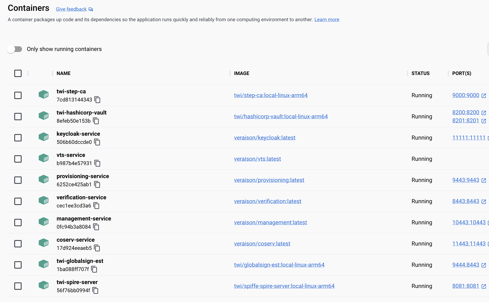

# Docker Build and Deployment

This document explains how to build Docker images for all TWI stack components and deploy them locally or to remote hosts.

## Overview

Twium provides two Docker paths:

1. **TWI stack components** via `components.sh` (EST, Vault, SPIRE, step-ca, Veraison).
2. **PoC attester** via `docker compose` in this directory: a workload **client** plus a **CAI sidecar**. The sidecar talks to CAAPI; the client only calls `AcquireCredential`, then authenticates to the PoC HTTPS server with mTLS and a JWT.

The dispatcher (`components.sh`) manages:

- **globalsign-est**: RFC 7030 EST server for certificate enrollment
- **hashicorp-vault**: Secrets and identity management platform
- **spiffe-spire**: Workload identity and SVID issuance (server + agent)
- **step-ca**: Online CA for TLS/SSH/ACME certificates
- **veraison-services**: Attestation verification services

`veraison-apiclient` is a client library and is not deployed as a service. The PoC **client**, **CAI sidecar**, and **server** images are built from Dockerfiles in this repository (see [PoC Client and CAI Sidecar](#poc-client-and-cai-sidecar)); they are not started by `components.sh`.

## Prerequisites

### Docker Installation

**macOS:**
1. Install Docker Desktop from [docker.com](https://www.docker.com/products/docker-desktop)
2. Start Docker Desktop from Applications
3. Verify Docker is running: `docker info`

**Ubuntu/Linux:**
```bash
# Install Docker Engine
sudo apt-get update
sudo apt-get install -y docker.io docker-compose-plugin

# Add your user to the docker group (requires logout/login)
sudo usermod -aG docker $USER
newgrp docker  # Or logout and login again

# Verify Docker access
docker info
```

### File Sharing (macOS Only)

For Docker Desktop on macOS, ensure the workspace directory is shared:
1. Open Docker Desktop → Settings → Resources → File sharing
2. Add `/Users/sudsadmin/Downloads/vscode_worspaces/twi-unified-model`
3. Add the parent directory of your `DEPLOY_CONFIG_DIR` if using an external config location

## The components.sh Deployment Script

### Location

```
./twium/deploy/components.sh
```

Run the commands in this guide from the `twium/` directory unless a section
states otherwise:

```bash
cd /Users/sudsadmin/Downloads/vscode_worspaces/twi-unified-model/twium
```

### Usage

```bash
./twium/deploy/components.sh <build|deploy|stop|status> [options]
```

### Commands

| Command | Description |
|---------|-------------|
| `build` | Build Docker images from source for selected components |
| `deploy` | Start containers from previously built component images |
| `stop` | Stop running containers |
| `status` | Show container status |

### Options

| Option | Description | Example |
|--------|-------------|---------|
| `--components LIST` | Comma-separated component list or `all` (default: `all`) | `--components globalsign-est,step-ca` |
| `--config-dir PATH` | Runtime configuration directory | `--config-dir "$HOME/twi-config"` |
| `--platform PLATFORM` | Docker platform (auto-detected by default) | `--platform linux/amd64` |
| `--docker-host ENDPOINT` | Remote Docker daemon endpoint | `--docker-host ssh://user@vm.example` |
| `--dry-run` | Print commands without executing | `--dry-run` |
| `-h, --help` | Show help message | `-h` |

### Component List

Valid components:
- `globalsign-est`
- `hashicorp-vault`
- `spiffe-spire`
- `step-ca`
- `veraison-services`

Or use `all` to select all components.

## Source Builds and Docker Images

All images are built from the checked-out workspace source code. The dispatcher never silently pulls published application images.

### Image Tags and Build Definitions

| Component | Dockerfile Location | Local Image Tag | Container Name | Ports |
|-----------|---------------------|-----------------|----------------|-------|
| globalsign-est | `globalsign-est/Dockerfile` | `twi/globalsign-est:local-<platform>` | `twi-globalsign-est` | 9444 (host) -> 8443 (container) |
| hashicorp-vault | `hashicorp-vault/scripts/docker/Dockerfile` | `twi/hashicorp-vault:local-<platform>` | `twi-hashicorp-vault` | 8200, 8201 |
| spiffe-spire | `spiffe-spire/Dockerfile` (multi-stage) | `twi/spiffe-spire-server:local-<platform>`, `twi/spiffe-spire-agent:local-<platform>` | `twi-spire-server`, `twi-spire-agent` | 8081 |
| step-ca | `step-ca/docker/Dockerfile` | `twi/step-ca:local-<platform>` | `twi-step-ca` | 9000 |
| veraison-services | Uses existing `make docker-deploy` | Project-owned `veraison/*` images | Multiple containers | Various |

### Platform Auto-Detection

The script automatically detects your platform:
- Apple Silicon (M1/M2/M3): `linux/arm64`
- Intel/AMD x86_64: `linux/amd64`

Override with `--platform` when building for remote deployment (e.g., building ARM images on an Intel Mac for transfer to an ARM VM).

## PoC Client and CAI Sidecar

The attester (HTTP client) runs in Docker and does **not** link the CAI library. It calls a CAI sidecar over gRPC. The sidecar owns the platform plug-in and the CAAPI client.

```
┌─────────────┐   AcquireCredential gRPC   ┌──────────────┐  CAAPI gRPC   ┌─────────────────────┐
│ client      │ ─────────────────────────► │ cai sidecar  │ ────────────► │ server :9090 (CAS)  │
│ (attester)  │                            │ :50051       │               └─────────────────────┘
└──────┬──────┘                            └──────────────┘
       │ HTTPS mTLS + Bearer JWT
       ▼
┌─────────────────────┐
│ server :8443 (RUP)  │
└─────────────────────┘
```

`docker-compose.yml` starts **cai** and **client**. The PoC **server** (CAAPI + HTTPS mTLS) is expected on the host unless you point the compose file at another address.

### Prerequisites

From `twium/`, generate protobuf stubs **before** building images. The Dockerfiles copy `gen/go/` into the build context:

```bash
cd twium
make proto
```

The host must be able to reach Docker (`docker info`). On Linux, `extra_hosts: host.docker.internal:host-gateway` in the compose file lets containers reach services on the host.

### Quick start (server on the host)

Terminal 1 — PoC server (CAAPI `:9090`, HTTPS mTLS `:8443`):

```bash
cd twium
make server
./bin/server
```

Terminal 2 — sidecar + client:

```bash
cd twium
docker compose up --build
```

The client container calls the sidecar at `cai:50051`, acquires an X.509 client certificate and a JWT, then GETs `https://host.docker.internal:8443` with mTLS and `Authorization: Bearer <jwt>`. On success it prints `Received valid URI: https://example.com/received` and exits. Compose then stops the sidecar if you used `--abort-on-container-exit`:

```bash
docker compose up --build --abort-on-container-exit --exit-code-from client
```

Stop leftovers:

```bash
docker compose down
```

### Compose services

| Service | Dockerfile | Image (compose) | Role |
|---------|------------|-----------------|------|
| `cai` | `cai/Dockerfile` | `twium-cai` | CAI sidecar: platform plug-in + CAAPI client; gRPC `AcquireCredential` on `:50051` |
| `client` | `client/Dockerfile` | `twium-client` | Attester: calls the sidecar, then HTTPS mTLS + JWT to the server |

Build context for both is the `twium/` directory (not the subdirectory).

### Environment variables

| Variable | Set on | Default | Meaning |
|----------|--------|---------|---------|
| `CAAPI_ADDR` | `cai` | `host.docker.internal:9090` | CAS / CAAPI gRPC address the sidecar dials |
| `CAI_LISTEN` | `cai` | `:50051` | Sidecar listen address |
| `CAI_ADDR` | `client` | `cai:50051` (compose) | CAI sidecar gRPC address |
| `TLS_SERVER_NAME` | `client` | `localhost` | SNI / certificate hostname for the HTTPS server |
| `CLIENT_SERVER` | compose `command` | `https://host.docker.internal:8443` | HTTPS URL passed as the client argument |
| `HTTPS_ADDR` | host `./bin/server` | `:8443` | HTTPS mTLS listen address |
| `CAAPI_ADDR` | host `./bin/server` | `:9090` | CAAPI gRPC listen address |

Example: server not on the default host ports:

```bash
CAAPI_ADDR=host.docker.internal:19090 \
CLIENT_SERVER=https://host.docker.internal:18443 \
TLS_SERVER_NAME=localhost \
  docker compose up --build
```

`TLS_SERVER_NAME` should match a SAN on the server certificate (`localhost`, `twium-server`, `host.docker.internal`, `127.0.0.1`, or `::1`). The default `localhost` works with `https://host.docker.internal:8443` because verification uses SNI, not the TCP hostname.

### Build images without compose

```bash
cd twium
make proto
docker build -f cai/Dockerfile -t twium-cai .
docker build -f client/Dockerfile -t twium-client .
docker build -f server/Dockerfile -t twium-server .
```

`cai/Dockerfile` copies `cai/`, `platform/`, and `gen/go/`.  
`client/Dockerfile` copies `client/` and `gen/go/` only (no CAI library).  
`server/Dockerfile` copies `server/`, `cai/`, `platform/`, `gen/go/`, and `go.work`.

### Run the sidecar and client manually

```bash
docker network create twium-poc

docker run -d --name twium-cai --network twium-poc \
  --add-host host.docker.internal:host-gateway \
  -e CAAPI_ADDR=host.docker.internal:9090 \
  -e CAI_LISTEN=:50051 \
  twium-cai

docker run --rm --name twium-client --network twium-poc \
  --add-host host.docker.internal:host-gateway \
  -e CAI_ADDR=cai:50051 \
  -e TLS_SERVER_NAME=localhost \
  twium-client https://host.docker.internal:8443
```

With a user-defined bridge network, the sidecar's hostname is the container name (`twium-cai`), so set `CAI_ADDR=twium-cai:50051` instead of `cai:50051`. Compose DNS uses the service name `cai`.

### PoC server in Docker

Compose does not start the server. To run it in a container (CAAPI and HTTPS published to the host):

```bash
docker build -f server/Dockerfile -t twium-server .
docker run --rm -p 8443:8443 -p 9090:9090 --name twium-server twium-server
```

Then run `docker compose up --build` as above so the sidecar and client still use `host.docker.internal`.

### Local binaries (no Docker)

Same split, on the host:

```bash
make server cai client
./bin/server          # CAAPI :9090, HTTPS :8443
./bin/cai             # sidecar :50051, CAAPI 127.0.0.1:9090
./bin/client https://127.0.0.1:8443
```

### Ports

| Process | Port | Protocol |
|---------|------|----------|
| PoC server HTTPS (mTLS + JWT) | 8443 | HTTPS |
| PoC server CAAPI | 9090 | gRPC |
| CAI sidecar | 50051 | gRPC |

## Configuration Management

Runtime configuration, certificates, keys, and passwords are **intentionally external** to the repository.

### Configuration Directory Structure

Set via `--config-dir` or environment variable `DEPLOY_CONFIG_DIR`:

```bash
export DEPLOY_CONFIG_DIR="/path/to/config"
```

**Default:** `twium/deploy/config/local` (gitignored local development state)

**Recommended for local dev:** `twium/deploy/config/local` (gitignored)

### Expected Directory Layout

```
<config-dir>/
├── globalsign-est/
│   ├── estserver.json
│   └── certs/
│       ├── ca-certificates.pem
│       ├── ca-key.pem
│       ├── server-certificates.pem
│       ├── server-key.pem
│       └── client-ca.pem
├── hashicorp-vault/
│   └── config/
│       └── vault.hcl
├── spiffe-spire/
│   ├── server.conf
│   └── agent.conf              # Optional; starts local agent if present
└── step-ca/
    ├── config/
    │   └── ca.json
    └── secrets/
        └── password
```

See `deploy/config/README.md` for full configuration details.

## Local EST Configuration: init-local-est-config.sh

### Purpose

The `init-local-est-config.sh` script generates a **complete local development configuration** for the GlobalSign EST server, including:

- Mock CA certificate and private key (30-day validity)
- EST server TLS certificate and private key
- Client CA certificate for mTLS
- `estserver.json` configuration file with random health-check password

### Usage

```bash
export DEPLOY_CONFIG_DIR="$PWD/twium/deploy/config/local"
./twium/deploy/init-local-est-config.sh
```

### What It Creates

```
twium/deploy/config/local/globalsign-est/
├── estserver.json                    # EST server configuration
└── certs/
    ├── ca-certificates.pem           # Mock CA certificate
    ├── ca-key.pem                    # Mock CA private key
    ├── server-certificates.pem       # EST server TLS certificate
    ├── server-key.pem                # EST server TLS private key
    └── client-ca.pem                 # Client CA for mTLS
```

### Safety Features

- **Idempotent:** Refuses to overwrite existing configuration
- **Local-only:** All artifacts are generated with 30-day validity
- **Password Generation:** Creates a random health-check password
- **Gitignored:** `config/local/` is excluded via `.gitignore`

### Security Warnings

⚠️ **For local development only**. The GlobalSign `estserver` uses `internal/mockca` and is explicitly labeled non-production by upstream.

- Never use these certificates in production
- Never commit generated secrets to Git
- Rotate local configuration periodically

## Local step-ca Configuration: init-local-step-ca-config.sh

`init-local-step-ca-config.sh` creates a disposable local step-ca instance from
the already-built `twi/step-ca` image. It generates `config/ca.json`, CA
certificates and keys, Badger database state, and `secrets/password` under
`config/local/step-ca/`. The password and private-key contents are not printed.

```bash
./twium/deploy/components.sh build --components step-ca
./twium/deploy/init-local-step-ca-config.sh
```

When `DEPLOY_CONFIG_DIR` is the default `twium/deploy/config/local`, deploying
step-ca runs this initializer automatically if the complete local configuration
is absent. Existing or partial state is never overwritten; use the explicit
initializer only after intentionally removing incomplete local state.

## Local Vault and SPIRE Configuration

`init-local-hashicorp-vault-config.sh` creates a disposable Vault file-storage
configuration with an HTTP listener and UI enabled. `init-local-spiffe-spire-config.sh`
creates an evaluation-only SPIRE server configuration using SQLite, a disk key
manager, and join-token node attestation. Both are invoked automatically during
deployment when the default local configuration directory has no state.

### Initialize and Unseal Local Vault

After deploying Vault for the first time, initialize it and retain the output
in an approved secret store. The local Vault listener uses HTTP, so set
`VAULT_ADDR` for each command:

```bash
docker exec -it -e VAULT_ADDR=http://127.0.0.1:8200 \
    twi-hashicorp-vault vault operator init
```

The initialization output includes unseal keys and a root token. Do not commit,
share, or paste those values into logs. Use the required number of distinct
unseal keys to unseal Vault; for each key, run:

```bash
docker exec -it -e VAULT_ADDR=http://127.0.0.1:8200 \
    twi-hashicorp-vault vault operator unseal
```

Confirm Vault is initialized and unsealed:

```bash
docker exec -e VAULT_ADDR=http://127.0.0.1:8200 \
    twi-hashicorp-vault vault status
```

The SPIRE helper creates only `server.conf`; it intentionally does not create
`agent.conf`, because an agent needs a join token and host-specific
node/workload-attestation configuration.

## Component-Specific Dockerfiles

### globalsign-est Dockerfile

**Location:** `globalsign-est/Dockerfile`

```dockerfile
ARG GO_VERSION=1.26.5

FROM golang:${GO_VERSION}-alpine AS builder
WORKDIR /src
COPY . .
RUN CGO_ENABLED=0 go build -trimpath -ldflags='-s -w' -o /out/estserver ./cmd/estserver

FROM alpine:3.22
RUN addgroup -S est && adduser -S -G est est
COPY --from=builder /out/estserver /usr/local/bin/estserver
USER est
EXPOSE 8443
ENTRYPOINT ["/usr/local/bin/estserver"]
CMD ["-config", "/etc/est/estserver.json"]
```

**Key Features:**
- Multi-stage build to minimize image size (final: ~16 MB)
- CGO disabled for static binary
- Non-root `est` user for security
- Configuration mounted at `/etc/est/`

### hashicorp-vault Dockerfile

**Location:** `hashicorp-vault/scripts/docker/Dockerfile`

**Special Consideration:** Vault's build process requires Git metadata for version embedding and tool installation. The `.dockerignore` originally excluded `.git`, causing build failures. **This has been fixed** by removing `.git` from `.dockerignore`.

The Dockerfile runs `make bootstrap` which:
1. Installs internal/external Go tools
2. Uses `git rev-parse` to find the repository root
3. Embeds Git commit hash into the binary

### spiffe-spire Dockerfile

**Location:** `spiffe-spire/Dockerfile` (root of spiffe-spire repo)

Multi-stage build producing two images:
- `twi/spiffe-spire-server:local-<platform>` - SPIRE server
- `twi/spiffe-spire-agent:local-<platform>` - SPIRE agent

### step-ca Dockerfile

**Location:** `step-ca/docker/Dockerfile`

Builds the `step-ca` binary and sets up the CA environment. The mounted configuration directory is read-write because step-ca maintains state in `/home/step`.

### veraison-services

Uses the existing Veraison project's own `make docker-deploy` workflow. The dispatcher invokes this for veraison-services instead of building a custom image.

### PoC CAI sidecar, client, and server

These images are **not** built by `components.sh`. Build them from `twium/` so the context includes `gen/go/` (run `make proto` first).

| Image | Dockerfile | Build context | Copies | Listens |
|-------|------------|---------------|--------|---------|
| CAI sidecar | `cai/Dockerfile` | `twium/` | `cai/`, `platform/`, `gen/go/` | gRPC `:50051` |
| Attester client | `client/Dockerfile` | `twium/` | `client/`, `gen/go/` | (one-shot; argument is the HTTPS URL) |
| PoC server | `server/Dockerfile` | `twium/` | `server/`, `cai/`, `platform/`, `gen/go/`, `go.work` | HTTPS `:8443`, CAAPI `:9090` |

CAI and client Dockerfiles set `GOWORK=off` and use Go `replace` directives to sibling modules. The client image does not contain the CAI library or platform plug-in.

## Deployment Workflows

### 1. Local Development Deployment

Build and deploy all components with local configuration:

```bash
# Select the gitignored local configuration directory.
# Deployment generates the EST mock CA and certificates when absent.
export DEPLOY_CONFIG_DIR="$PWD/twium/deploy/config/local"

# Build images, then deploy them.
./twium/deploy/components.sh build --components all
./twium/deploy/components.sh deploy --components all
```

### 2. Build Specific Components

```bash
./twium/deploy/components.sh build --components globalsign-est,step-ca
```

### 3. Deploy Built Images

Deploy requires the selected component images to already exist in the target Docker daemon:

```bash
./twium/deploy/components.sh deploy --components globalsign-est,step-ca
```

### 4. Cross-Platform Build (for VM deployment)

Build AMD64 images on Apple Silicon for an x86_64 VM:

```bash
./twium/deploy/components.sh build --components all \
    --platform linux/amd64
```

### 5. Remote Deployment

Deploy to a remote Docker daemon via SSH:

```bash
# Option 1: Build locally and transfer
docker save twi/globalsign-est:local-linux-amd64 | \
    ssh user@vm.example 'docker load'

# Option 2: Use remote Docker host directly
./twium/deploy/components.sh deploy --components globalsign-est \
    --docker-host ssh://user@vm.example \
    --config-dir /opt/twi-config
```

**Note:** `veraison-services` remains local-only through this dispatcher.

### 6. Check Status

```bash
./twium/deploy/components.sh status --components all
```

Or manually:

```bash
docker ps --filter "name=twi-"
```

### 7. Stop Components

```bash
./twium/deploy/components.sh stop --components all
```

## Container Management

### Persistent Data

Certain components use Docker volumes for persistent state:

- **Vault:** Named volume `twi-vault-data` stores unsealed Vault data
- **SPIRE Server:** Named volume `twi-spire-server-data` stores registration entries
- **step-ca:** Bind mount to config directory (read-write) for CA state

### Networking

All containers join the `twi-local` Docker bridge network for inter-component communication.

### Logs

View logs for any container:

```bash
docker logs twi-globalsign-est
docker logs -f twi-hashicorp-vault  # Follow logs
```

## Troubleshooting

### "cannot access the Docker daemon"

- **macOS:** Start Docker Desktop from Applications
- **Linux:** Start Docker service: `sudo systemctl start docker`
- **Permissions:** Ensure your user is in the `docker` group

### Bind Mount Fails (macOS)

Add workspace and config directories to Docker Desktop file sharing:
1. Docker Desktop → Settings → Resources → File sharing
2. Add paths, click Apply & Restart

### "missing image"

Build the selected component before deployment:

```bash
./twium/deploy/components.sh build --components <component>
```

### "required configuration ... missing"

Create the configuration directory structure documented in `deploy/config/README.md`. With `DEPLOY_CONFIG_DIR` set to `twium/deploy/config/local`, EST deployment automatically generates a missing mock-CA configuration. For external configuration directories, run `init-local-est-config.sh` explicitly only when a local mock-CA setup is intended.

### Port Already Allocated

Stop conflicting services or change published ports in the dispatcher script.

Default ports:
- EST: 9444 (host) -> 8443 (container)
- Vault: 8200, 8201
- SPIRE Server: 8081
- step-ca: 9000
- PoC server HTTPS: 8443
- PoC server CAAPI: 9090
- CAI sidecar: 50051 (compose network only unless you publish it)

If `docker compose up` fails with "connection refused" to `host.docker.internal:9090` or `:8443`, start `./bin/server` on the host first (or run the `twium-server` image as in [PoC server in Docker](#poc-server-in-docker)).

If the client fails TLS hostname verification, set `TLS_SERVER_NAME` to a SAN on the server certificate (`localhost` is the compose default).

### Container Exits Immediately

Check logs:

```bash
docker logs <container-name>
```

Common issues:
- Missing configuration files
- Invalid configuration syntax
- Missing certificates/keys
- Permission issues on mounted volumes

### Vault Build Fails with "fatal: not a git repository"

**Fixed:** Ensured `.git` is no longer in `hashicorp-vault/.dockerignore`. If you encounter this, verify:

```bash
grep -v "^#" hashicorp-vault/.dockerignore
# Should NOT contain ".git"
```

## Build Times

Approximate build times on Apple Silicon (M1/M2/M3):

| Component | Build Time | Image Size |
|-----------|------------|------------|
| globalsign-est | Under 1 minute | 16 MB |
| hashicorp-vault | 10-20 minutes when dependencies are uncached | 150 MB |
| spiffe-spire | 5-10 minutes | 150 MB (server), 62 MB (agent) |
| step-ca | 5-10 minutes | 147 MB |
| veraison-services | ~2-3 minutes | Varies |

Cross-platform builds (e.g., `--platform linux/amd64` on ARM) may take 2-3× longer due to emulation.

`components.sh` does not enforce a timeout for builds: `docker build` runs until Docker succeeds or reports an error. If the script is launched through an IDE task, CI job, or automation agent, configure that caller's timeout separately. For this workspace, allow at least 20 minutes for an uncached Vault build and 10 minutes for SPIRE or step-ca builds on Apple Silicon.

## Next Steps

After deploying components:

1. **Verify EST Server**:
   ```bash
    curl -k https://localhost:9444/.well-known/est/cacerts
   ```

2. **Check SPIRE Server**:
   ```bash
    docker exec twi-spire-server \
         /opt/spire/bin/spire-server healthcheck
   ```

3. **Test step-ca**:
   ```bash
    curl -k https://localhost:9000/health
   ```

## Deployment Reference

The following Docker Desktop view shows the local containers after deploying
the TWI components.



## See Also

- [Installation Prerequisites](readme_install_prereq.md) - Install Go and protoc
- [deploy/config/README.md](deploy/config/README.md) - Configuration directory structure
- [README.md](README.md) - Main project overview
- [proto/cai/v1/cai.proto](proto/cai/v1/cai.proto) - Attester-facing CAI gRPC (`AcquireCredential`)
- [docker-compose.yml](docker-compose.yml) - Client + CAI sidecar compose file
